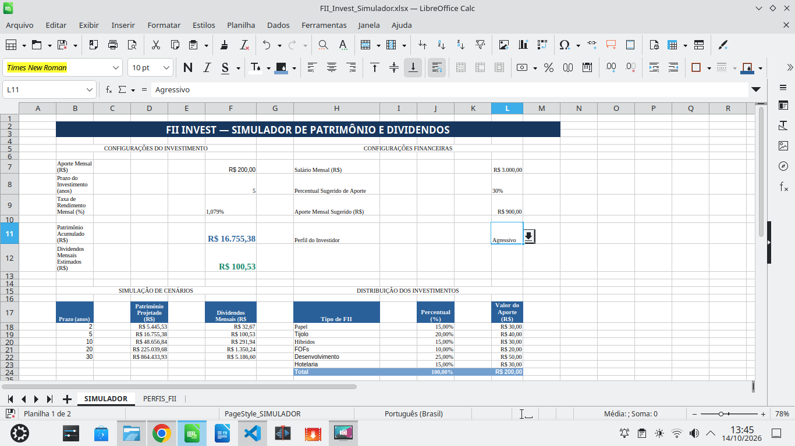

# FII Invest — Simulador de Patrimônio e Dividendos

## Sobre o projeto

Projeto desenvolvido como parte do desafio **Criando uma Ferramenta de Controle de Investimentos com Excel**, do Bootcamp DIO, com o objetivo de construir uma ferramenta para simulação de investimentos em Fundos de Investimento Imobiliário (FIIs).

A solução foi desenvolvida no **LibreOffice Calc** e disponibilizada em formato **Excel (.xlsx)**.

## Dashboard do Simulador

## Funcionalidades

- Configuração do aporte mensal, prazo e taxa de rendimento.
- Projeção do patrimônio acumulado utilizando a função VF.
- Estimativa de dividendos mensais.
- Simulação de cenários para 2, 5, 10, 20 e 30 anos.
- Cálculo de aporte sugerido com base no salário e percentual escolhido.
- Seleção dos perfis Conservador, Moderado e Agressivo.
- Distribuição automática do aporte entre seis categorias de FIIs.
- Utilização de PROCV, SOMA, validação de dados e intervalos nomeados.

## Estrutura do arquivo

- **SIMULADOR:** configurações, indicadores, cenários e distribuição dos aportes.
- **PERFIS_FII:** tabela auxiliar com percentuais de alocação por perfil.

## Exemplo de simulação

| Indicador | Valor |
|---|---:|
| Aporte mensal | R$ 200,00 |
| Prazo | 5 anos |
| Rendimento mensal hipotético | 1,079% |
| Patrimônio projetado | R$ 16.755,38 |
| Dividendos mensais estimados | R$ 100,53 |

Os resultados são projeções matemáticas baseadas em premissas fixas. Não representam promessa de rentabilidade nem recomendação de investimento.

## Tecnologias e recursos

- LibreOffice Calc
- Microsoft Excel (.xlsx)
- Funções VF, PROCV e SOMA
- Validação de dados e intervalos nomeados
- Visual Studio Code
- Git e GitHub

## Arquivo do projeto

[FII_Invest_Simulador.xlsx](./FII_Invest_Simulador.xlsx)

## Objetivo de aprendizagem

Aplicar conceitos de planilhas eletrônicas, fórmulas financeiras, organização de dados, automatização de cálculos e documentação técnica em um projeto prático para portfólio.
  